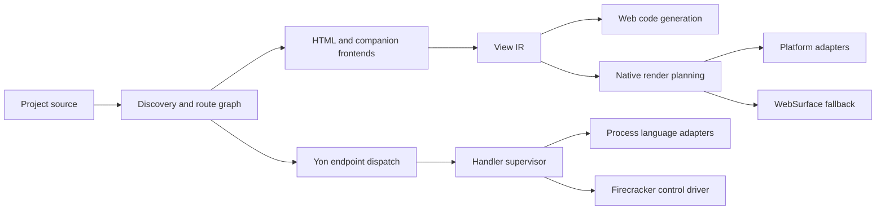
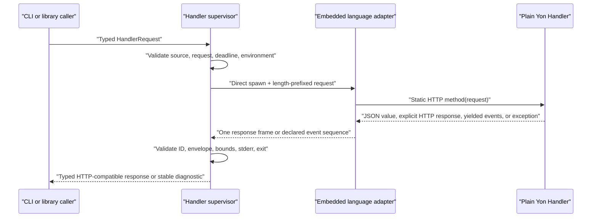
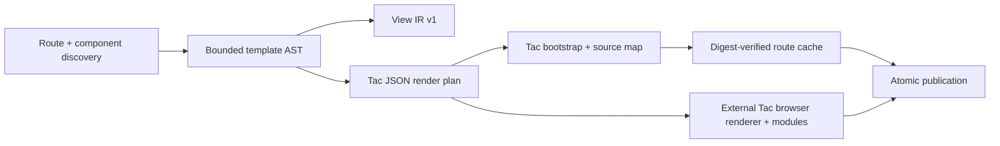
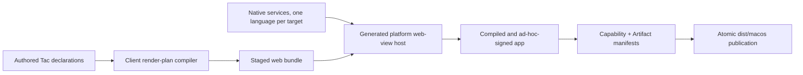

# Rust Rewrite Architecture

## Shape

Tachyon is a modular monolith: one program built from separate modules. The
command-line interface (CLI) coordinates typed modules that run in the same
process. It does not add internal network services.

The framework owns the process tree of every external build tool:

- It reads stdout and stderr at the same time into fixed-size diagnostic
  buffers.
- One absolute deadline covers the whole tool run.
- It terminates and reaps every descendant process, even when the parent
  process exits successfully.

Development topic SSE (server-sent events) uses one hub that the runtime owns.
It does not start one reader per client. Each topic has one incremental reader,
bounded replay and broadcast buffers, and explicit global and per-topic
admission.

## Dependency Direction

Local application events have their own lifecycle, which the framework owns
(ADR 0028). A shared annotation frontend validates their metadata. Three
adapters run it:

- the browser adapter, within one document;
- the native adapter, within one activation;
- the Yon adapter, within one invocation.

Listeners are registered before OnStart runs. OnStop releases the
object graph once. In the browser, Resource injection replaces `this.tac`. It
does not add browser objects to the Yon or native language adapters. These
events are not the topic SSE transport described above.

The modules depend on each other in one direction:

- Diagnostics and the public contract types do not depend on compiler,
  server, runtime, or platform code.
- Discovery depends on project configuration and diagnostics.
- Frontends depend on diagnostics. They emit validated source structures.
- Lowering depends on frontend structures. It emits View IR (the
  intermediate representation of a view).
- Web and native backends read View IR. They do not change it. Yon endpoints
  are not part of the view pipeline.
- The handler supervisor depends on the Handler Protocol, not on the internal
  API of a language runtime.
- Platform web-view hosts read the client bundle and the declared
  capabilities.
- The CLI may depend on every orchestration module. No library depends on the
  CLI.

Circular crate dependencies are forbidden. A module calls back into another
module through a trait that the consumer owns, but only when a concrete
dependency would reverse the direction above.

## Compiler Pipeline

1. Discover project files. Do not run application code.
2. Make project-relative paths canonical. Reject paths that escape the project
   and file system shapes that are not supported.
3. Build and validate a deterministic route graph.
4. Parse HTML and companions, and keep their source spans.
5. Resolve bindings, components, and control-tag structure.
6. Lower to versioned View IR.
7. Validate target capabilities and fallback boundaries.
8. Generate target output into a staging directory.
9. Verify the artifact manifest.
10. Publish the complete output atomically.

Every stage takes immutable input. It returns either immutable output or a
bounded set of stable diagnostics.

Before annotation composition, a shared lexical check enforces one authored
class and imports per annotated or Yon handler file (ADR 0044). Controller
annotations define Yon paths and verbs (ADR 0048); old route markers are refused.
Test configuration composition reads
only the named same-language sibling through bounded, no-follow access; test
files never become production role modules. Composed compiler output is not
revalidated as a single authored class.

## Web Compiler and Server

| Crate | Owns |
| --- | --- |
| `tachyon-cli` | Argument and diagnostic presentation. |
| `tachyon-core` | Project discovery, the static route graph, bounded HTML tokenization, staged publication, scaffolding, and the development server. |
| `tachyon-contracts` | Route Manifest v1 and the repository policy tests. |
| `tachyon-diagnostics` | Diagnostics v1. |

The compiler emits each Tac route as a deterministic bootstrap document plus
bounded client render plans. It never renders the Tac view structure on the
server. Yon is not a compiler frontend, and the compiler rejects `yon.html`.
The compiler also emits View IR, source maps, client modules, shared assets,
and an offline service worker. It writes all of them into a staging directory
and then publishes them atomically.

The server reads that generated output. It:

- matches exact or dynamic route patterns;
- dispatches Yon REST handlers and middleware through the supervisor;
- keeps the last good build when a watched rebuild fails.

In development, an event-driven watcher sorts each successful source change
into one of three kinds:

- a stylesheet update;
- a client render-plan update;
- a safe fallback to a full reload.

It publishes the change with Hot Update Protocol v1 over SSE. Diagnostics do
not replace the running page. The server injects the hot-update client only
while it serves. That client does not enter production artifacts. See ADR 0013.

## Handler Data Path

| Module | Owns |
| --- | --- |
| `tachyon-core::handler` | Source validation, framing, runtime adapter materialization, environment policy, concurrency admission, process lifecycle, and response validation. |
| `tachyon-contracts` | The typed public envelope shapes. |

`tachyon-cli` turns command arguments and Ctrl-C into one invocation. It does
not parse output that is specific to one adapter.

### Project snapshot

Project discovery opens one capability root. It reads Tac pages, components,
shared assets, web and native configuration, Yon, and the complete server
source boundary. It does not follow any component. The route graph keeps the
captured Tac and companion bytes. The project owns one private snapshot with
the same shape as the project.

Web compilation, native planning, and supervised handler execution all reuse
that snapshot, including their working directories. Native compilation never
discovers the project again. Development-server startup also takes these from
the same one Project:

- its first web build;
- route dispatch;
- the selected root middleware;
- worker schedules;
- worker HandlerSources.

Replacing an authored file or the project root after discovery cannot redirect
an input. A hot-update rebuild runs one new discovery and builds from that new
snapshot.

### Runtime readiness

The server first resolves and probes the runtime requirements of those
HandlerSources, with duplicates removed. It does this before it prepares
output, binds a socket, makes routes and middleware ready, or starts workers.
The same order applies with `--no-bundle`. A static-only Project has an empty
set of runtime requirements.

- JavaScript and TypeScript share the selected JavaScript runtime.
- Java and Kotlin share the Java runtime. Kotlin still needs its compiler too.
- Firecracker mode validates the exact set of discovered languages and the
  configured driver before the server can become observable.
- C# readiness finds the major version of the installed SDK. It then builds a
  minimal project that the framework owns, with isolated temporary CLI and
  NuGet state. Listing `Microsoft.NETCore.App` alone does not count as ready.

### Server task lifetime

The development server owns the watcher and every scheduled-worker task:

- The tasks start with `run_until`.
- They receive cooperative cancellation at shutdown.
- The server waits for them under a bounded settlement deadline before it
  returns.

Dropping a bound server starts no tasks. Dropping a running server future
aborts every task that it owns.

Streaming-handler bridges, hot-update SSE, and topic SSE share the same runtime
lifetime. At shutdown the server:

1. closes producer admission;
2. cancels active response producers and request handlers before Axum drains
   connections;
3. force-closes the HTTP future before the final reserved settlement slice;
4. aborts and join-drains both task registries under the one global deadline.

While admission is open, the server removes completed producer records at
regular intervals, so the records do not grow with the request count.

An infinite streaming invocation receives its cancellation signal. The server
then drops it through the supervised process-group guard and does not poll it
again. This stops a producer in a ready loop from taking over shutdown, and
the process is still killed and reaped. The cooperative task drain yields
every 16 joins. A client disconnect also closes its bridge and reaps its
streaming child process.

Worker schedules stay fixed to the startup Project for the life of that server
process. To change `.tachyonrc.workers`, restart the server. A web hot rebuild
does not replace live schedules.

### Isolation backends

The supervisor chooses its isolation backend only from the environment of the
parent process:

- Process mode starts one language child process per request.
- Firecracker mode starts a trusted control client. For JavaScript and Python,
  the client passes the same framed request to a microVM (small virtual
  machine) pool that the operator owns.

The supervisor rejects TypeScript and the prepared Java, PHP, Kotlin, C#, and
Rust paths before it starts the driver. The current contract cannot transfer
their artifact sets. Project files and handler requests cannot weaken the
choice of backend. See ADR 0014.

### Process supervision

The supervisor starts its child process or control client without a shell.

- Protocol stdout accepts one bounded response frame, or a bounded sequence of
  event frames from a native generator method.
- The supervisor reads stderr separately and bounds it.
- Queueing, startup, execution, framing, and exit share one deadline.
- On cancellation, the supervisor sends the protocol cancel frame and waits a
  short grace period. When required, it then kills and reaps the process.
- Process-mode handlers are never pooled or reused.

A missing runtime has its own mapping: `TY2112`. The startup probe and the
later process spawn use the same logical runtime identity. So if an executable
is removed between them, the result is still `TY2112`, not a generic spawn
failure. Human diagnostics, JSON diagnostics, and structured invocation events
show only a fixed label for the runtime family or configuration. Raw
executable paths and operating-system errors stay private.

### Yon languages and annotations

Yon owns ten language paths: JavaScript, TypeScript, Python, Java, C#,
Kotlin, PHP, Rust, Dart, and Go. HTTP routes come from `RequestRoute`
controllers in `server/controllers/` (ADR 0048), with providers scoped to
the entry. Go annotations are comments such as `// @Service` (ADR 0050).
Workers and root middleware retain their separate entry contracts.

Annotation discovery works in three steps:

1. It infers required-field dependencies, or reads explicit `Needs` tokens.
2. It validates scope relationships, cycles, route paths and instance methods
   marked with `GetRoute`, `PostRoute` and the other supported verbs.
3. It generates direct calls into the existing Handler ABI (application binary
   interface).

It never imports application modules to discover metadata. Route annotations
are the only HTTP dispatch declarations; legacy verb-named route files are
refused with migration guidance. Provider and helper methods do not register routes.
Singleton and request instances share a cache that is local to the invocation.
Transient instances do not. Process mode does not keep providers between
requests.

See:

- ADR 0021 for the annotation grammar;
- ADR 0024 for the strict role layout;
- [ADR 0027](../adr/0027-scoped-discovery-and-managed-resources.md) for
  automatic entry-scoped discovery;
- [ADR 0031](../adr/0031-realms-mirror-each-other.md) for the shared role
  folders;
- [ADR 0048](../adr/0048-yon-routes-come-from-annotations.md) for controller
  routes and signature-derived request and response types;
- [ADR 0050](../adr/0050-go-annotations-are-comments.md) for Go comment markers.

The compiler visits the realm's `client/<role>` or `server/<role>` folders in
the immutable captured snapshot. It selects shared role files in the same
language and excludes sibling route controllers. It never follows symlinks or loads application imports for
discovery. The compiler rejects authored module manifests. The assembled unit
shares one behavior registry that is local to the source. The compiler
validates the unit before it selects a runtime.

For JS/TS (JavaScript and TypeScript) and Python, the compiler orders type
dependencies at declaration time. The normal language initialization rules
still apply to dynamic computations. A `static field =` initializer on its own
line with a directly interpolated template literal fails closed. Move such work
into methods that run after construction; do not rely on scan order. This
narrow check does not evaluate dynamic initialization hidden in calls or other
expressions.

### Constructor inference

NeedsAll inference reads only the source:

- Yon typed fields resolve to exact concrete providers.
- JavaScript uses exact lowerCamel provider names.
- Rust requires `Arc<Provider>`.

Declaration order, or an explicit quoted field list, sets the order of the
generated assignments. Inference does not select fields with defaults or static
fields. Ambiguity fails. The resulting plan keeps the existing bounds and
scopes.

Yon also recognizes the reserved provider tokens DataSource, Redis, and
ApplicationEventPublisher. Tac JS/TS can inject scoped Client declarations into
a service through NeedsAll. Native services keep explicit client
ownership and configuration. See ADR 0025 and ADR 0027.

### Managed resources

Yon datasource and Redis settings create server-owned resources from the
private application snapshot. The datasource driver is one of the SQL dialects
or `fylo`. `fylo` is a local document store that the server runs through one
subprocess that it owns ([ADR 0032](../adr/0032-fylo-datasource.md)). Every
Yon language reaches these resources through a loopback capability that the
invocation owns, never through a public REST route.

- The server owns connection lifetime, admission, and shutdown. Each handler
  process stays disposable.
- SQL parameters are bound, not interpolated.
- Redis stays a separate key/value resource.
- Startup never changes schemas.
- Application authorization and transaction policy stay explicit.
- Firecracker mode rejects this resource configuration until its transport
  supports the capability boundary.

Driver qualification is recorded separately from release support. See ADR 0027
for the ownership and failure contracts.

### Shared behavior frontend

Before controller and DI (dependency injection) lowering, the shared behavior
frontend removes validated markers. It emits native wrappers or registrations
that are local to the source. The markers are global in every language, and
JS/TS refuses an import from `tachyon:behaviors` (ADR 0046). Tac's service
compiler and the native service registry use the same frontend.

Runtime configuration is explicit and never runs during compilation. The
selected adapters own cache storage, persistence, and outbound HTTP. Contexts
carry an explicit partition, cancellation, and a bounded operation lifetime.

This API is not:

- a server renderer;
- a bridge that gives database credentials to the browser;
- a global DI container;
- a global application scanner based on reflection.

Every Yon language implements the shared annotations. So do Tac's JS/TS,
Swift, Kotlin, C#, Rust, and Go services. This includes cache mutations, typed
configuration and activation, DTO (data transfer object) validation, and
compiled repository queries.

- Shared policy modules own literal validation, query derivation, and
  source-local schema binding.
- Language emitters own the executable adapters.
- Query authorization is separate from cache authorization.
- Native owners manage their context lifetimes explicitly.
- Synchronous adapters check deadlines cooperatively.

See ADR 0022.

### Responses, relay, and streaming

A handler may return `{status, headers, body}`. A body with an explicit
`Content-Type: text/html` passes through unchanged. Tachyon never treats a Yon
response as a Tachyon template.

Other programs sit behind an explicit `relay(command, request)` call. The
prelude for each language reads the delegate's stdout and stderr at the same
time under fixed bounds. It also sanitizes failures, so private details do not
leak. The supervisor owns the absolute request deadline and the complete
process group.

Generator methods yield framed events in the six languages that support
generators: JavaScript, TypeScript, Python, PHP, Kotlin, and C#. A subscriber
disconnect is a lifecycle event: it terminates and reaps the group. See
ADR 0020.

The server uses this path for HTTP dispatch, middleware, and scheduled workers.
These entry points use the same boundary in every Yon language. `.tachyonrc.workers`
schedules workers but cannot register an interpreter. Root middleware and
workers are protocol entry points with the Handler shape. Their source,
dependencies, and working directory come from the Project's owned snapshot.
Builds never run them.

A Firecracker control program may use a warm pool. Pool and snapshot
correctness remain the responsibility of its qualified deployment. Its current
transport supports only JavaScript and Python.

## View Data Path

Configuration has two separate inputs (ADR 0026, ADR 0034):

- Tac's public configuration is the `tac` member of `client/manifest.json`,
  the web app manifest. Discovery validates it. The web compiler publishes the
  manifest at `/manifest.webmanifest` for web and staged native hosts.
- `server/application.json` (Application Configuration v3) belongs to Yon only.

Neither `.env` nor Yon profile files take part in client builds. Server startup
separately loads namespaced configuration and bounded literal `.env` secrets
from the retained project capability. Only supervised invocations receive the
resolved private `YON_APPLICATION_JSON` snapshot. Setting and property binding is
explicit. In every Yon adapter, JSON result normalization stays separate
from the optional helpers for HTTP status, headers, and raw-body responses.

`tachyon-core::template` owns expression parsing, control validation, component
resolution, client-plan encoding, and source mapping. The compiler validates
every view without running handlers. It treats earlier build state as
untrusted and publishes only a complete staged output. At runtime, the bounded
Tac renderer creates the whole Tac DOM and owns structural rerenders. Yon stays
a separate HTTP dispatch path. Navigation between documents stays native to the
browser. See ADR 0015.

## Native Data Path

`tachyon-core::native` owns:

- strict application configuration;
- native service language selection;
- deterministic route registries;
- bridge boundaries for the local origin;
- generated host source;
- supervised toolchain execution;
- manifests;
- atomic publication.

WKWebView, Android WebView, WebKitGTK, and WebView2 all read the same
client-rendered web bundle. Native services compile with the normal platform
toolchains. A bounded registry dispatches to them by service instance name. The
page's canonical route bounds every request (ADR 0030). Remote content and
subframes never receive a native bridge. See ADRs 0018 and 0019 for the
explicit migration from the released widget/WASM (WebAssembly) architecture.

## Compatibility Boundary

There is no legacy framework implementation in the tree. `website/` builds
through Rust. It is a real project for migration and multi-target acceptance.
The immutable v26.30.04 release binary is the external reference for behavior
(the behavioral oracle). `corpus/` holds the neutral fixtures that both
implementations share.

A new compatibility fixture must name the observable behavior that it
preserves. It must not contain private implementation logic, generated caches,
private data, or incidental implementation details.
